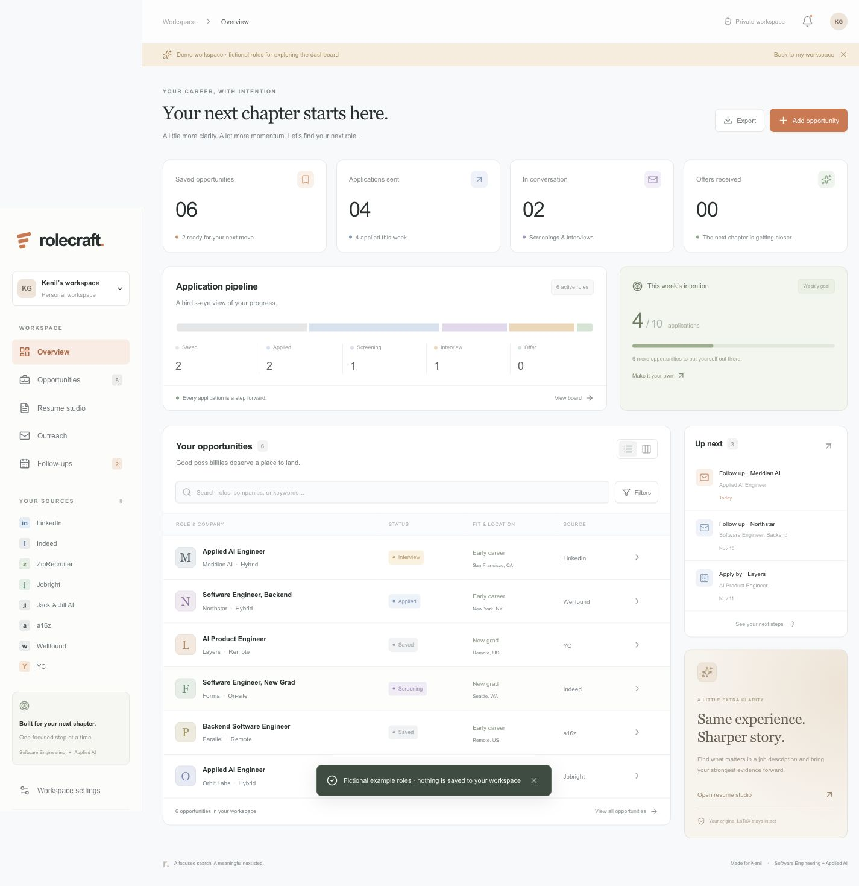
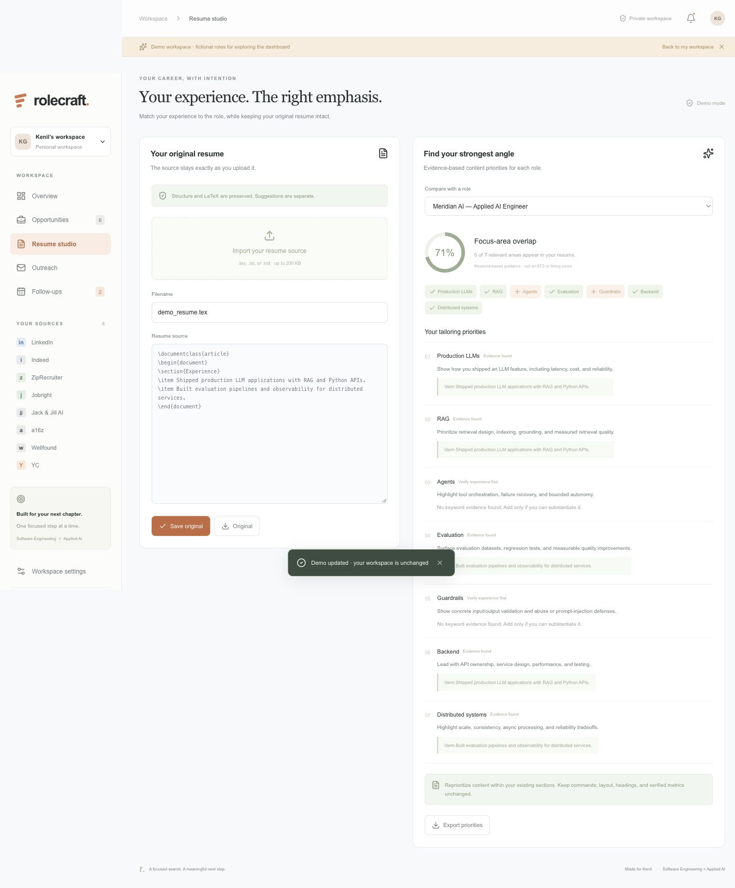
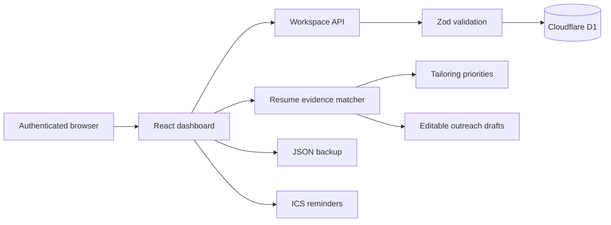

# Rolecraft

**A private career workspace for Software Engineer and Applied AI Engineer job searches.**

Rolecraft brings opportunities, application stages, resume evidence, recruiter outreach, deadlines, and follow-ups into one focused dashboard. It is designed around production AI and backend roles, with dedicated coverage for LLM applications, RAG, agents, evaluation, guardrails, observability, and distributed systems.

[Open the private Site](https://kenil-career-workspace.san-jose-sta-2217.chatgpt.site/) · [Explore features](#what-rolecraft-does) · [Run locally](#local-development)

> The hosted Site is private and requires an authorized account. The screenshots below use Rolecraft's clearly labeled fictional demo workspace; they contain no personal application or resume data.



## Why Rolecraft

A serious job search quickly spreads across job boards, browser tabs, notes, calendar reminders, resume copies, and half-finished recruiter messages. Rolecraft keeps that work connected:

1. Save a promising role from any platform.
2. Record the facts that affect fit: role track, location, work mode, authorization, sponsorship, and career level.
3. Track the opportunity from saved through offer.
4. Compare its description with the original resume source.
5. Turn the comparison into evidence-based resume priorities and an editable outreach draft.
6. Schedule the next action and export it to a calendar.

## What Rolecraft does

### Opportunity tracking

- Saves roles from LinkedIn, Indeed, ZipRecruiter, Jobright, Jack & Jill AI, a16z, Wellfound, YC, and other sources.
- Supports list and application-board views.
- Filters by role track, location, work mode, sponsorship, work authorization, new-grad or early-career fit, platform, and application status.
- Stores job links, descriptions, recruiter details, notes, application dates, deadlines, and follow-up dates.
- Tracks stages across Saved, Applied, Screening, Interview, Offer, Rejected, and Withdrawn.

### Resume studio

- Imports `.tex`, `.txt`, or `.md` resume source up to 200 KB.
- Preserves the original text, whitespace, LaTeX commands, headings, structure, and verified metrics.
- Compares a job description with eight engineering focus areas:
  - production LLM applications
  - retrieval-augmented generation
  - agents and tool calling
  - evaluation
  - guardrails
  - observability
  - backend engineering
  - distributed systems
- Shows the exact resume evidence found for each relevant area.
- Exports separate tailoring priorities without rewriting the original resume.
- Marks missing evidence as something to verify instead of inventing experience.



### Outreach and follow-ups

- Generates editable recruiter introduction and follow-up templates.
- Uses only matching evidence from the supplied resume and leaves an explicit placeholder for a verified project result.
- Never sends a message automatically.
- Surfaces upcoming deadlines and follow-ups in the dashboard.
- Exports `.ics` calendar reminders with an alert.

### Ownership and portability

- Exports the complete workspace as a validated JSON backup.
- Restores backups after explicit confirmation.
- Includes an isolated fictional demo mode that never changes the saved workspace.
- Keeps the default workspace empty, so no personal records are committed to this repository.

## Product boundaries

Rolecraft is intentionally transparent about what it does today:

- Job sources are shortcuts to external platforms. Listings and descriptions are entered manually; the app does not scrape job boards.
- Resume comparison is deterministic keyword evidence, not a semantic LLM review or an ATS score.
- Outreach uses editable templates and is never sent on the user's behalf.
- Sponsorship and work-authorization fields record verified listing details; they are not legal or immigration advice.
- In-app reminders appear when Rolecraft is open. Calendar export provides notifications outside the app.

## Architecture



Each signed-in visitor is identified by a Site-scoped user ID. The API validates every read and write server-side, stores one workspace document per user, and uses a revision number to reject stale updates from another tab.

| Layer       | Technology                                   | Responsibility                                            |
| ----------- | -------------------------------------------- | --------------------------------------------------------- |
| UI          | React 19, TypeScript, Tailwind CSS 4, Lucide | Responsive dashboard and interactive workflows            |
| Runtime     | Vinext with Next-compatible App Router APIs  | Server rendering, routes, and Cloudflare Worker output    |
| Validation  | Zod                                          | Job, resume, backup, and workspace validation             |
| Persistence | Cloudflare D1, Drizzle ORM                   | Private user-owned workspace storage                      |
| Hosting     | ChatGPT Sites, Cloudflare Workers            | Authentication, private access, and production deployment |
| Tooling     | Vite, TypeScript, Prettier, Node test runner | Development, builds, formatting, and regression tests     |

## Data and privacy

- Hosted pages and API routes require Site authentication.
- Records are keyed by the authenticated visitor's Site-scoped ID.
- Write requests reject cross-origin submissions.
- Optimistic concurrency prevents an older tab from silently overwriting newer work.
- Job URLs accept only valid `http` or `https` links.
- Personal resume and application data live in D1, not in Git.
- Demo jobs and demo resume content are fictional and remain isolated from saved data.

## Local development

### Requirements

- Node.js 22.13 or newer
- npm

### Install and build

```sh
npm ci
npm run build
```

### Initialize the local database

Build once before applying the migration because the command uses the generated Wrangler configuration:

```sh
node --import ./scripts/sites-env.mjs \
  ./node_modules/wrangler/bin/wrangler.js d1 execute DB \
  --local \
  --config dist/server/wrangler.json \
  --persist-to .wrangler/state \
  --file drizzle/0000_keen_senator_kelly.sql
```

Apply each migration only once to a given local database. Local and production D1 data are separate.

### Start the app

```sh
npm run dev -- --host 127.0.0.1
```

The development server provides a loopback-only mock user. Production authentication is handled by Sites.

## Verification

```sh
npm run typecheck
npm test

# Run with the local dev server and database available
npm run test:api

npm run build
```

The test suite covers:

- byte-for-byte resume source preservation through validation and JSON round trips
- focus-area matching and missing-evidence behavior
- outreach drafts that avoid invented project claims
- calendar escaping and date rollover
- unsafe URL and impossible-date rejection
- authentication and origin enforcement
- D1 persistence and stale-write conflicts

API tests use only the local mock identity and restore the starting workspace after the test completes.

## Project structure

```text
.
├── app/
│   ├── api/workspace/route.ts   # Authenticated workspace API
│   ├── chatgpt-auth.ts          # Site identity helpers
│   ├── globals.css              # Responsive visual system
│   └── page.tsx                 # Protected page entry
├── components/
│   └── dashboard.tsx            # Product UI and interactions
├── db/
│   └── schema.ts                # D1 workspace table
├── drizzle/                     # Versioned database migration
├── lib/
│   └── workspace.ts             # Schemas, matching, outreach, calendar export
├── tests/                       # Domain and API regression tests
├── docs/assets/                 # Sanitized README screenshots
└── .openai/hosting.json         # Site identity and D1 binding
```

## Useful commands

| Command               | Purpose                                           |
| --------------------- | ------------------------------------------------- |
| `npm run dev`         | Start the local development server                |
| `npm run build`       | Create the production Worker build                |
| `npm run start`       | Run the built Worker locally                      |
| `npm run typecheck`   | Check TypeScript without emitting files           |
| `npm test`            | Run domain regression tests                       |
| `npm run test:api`    | Run API integration tests against the local app   |
| `npm run db:generate` | Generate a Drizzle migration after schema changes |
| `npm run format`      | Format source, tests, and documentation           |
